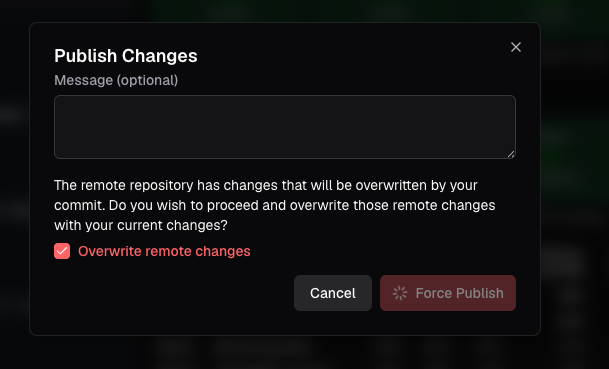

# Evidence Studio review — evidence and research notes

Prepared: **2026-11-01**. Companion to [[Evidence Studio - Product Review]]. The main report is intended to stand alone; this note supplies traceability and follow-up detail.

## Basis and confidence

The primary case is the Home Lab Analytics walkthrough, recorded in [[Home Lab Analytics - Review Log]]. **HLA-01–47 are log entries, not 47 independent tests or defects.** Later entries include questions, research, and design ideas. [[Product Review Findings]] retains the intermediate synthesis; [[Product Review Plan]] retains the investigation questions.

Evidence types are kept separate:

- **User report:** Sam's own experience, dictated during or after the task; not always accompanied by a capture.
- **Artifact:** The preserved publish screenshot, inspected again while preparing this report.
- **Agent record:** Claude's technical account of its build; useful supporting evidence, not an independent human reproduction.
- **Documentation/customer account:** Establishes a published capability or reported workflow, not actual performance in this evaluation.
- **Interpretation/proposal:** A possible explanation or improvement to test.

Priorities reflect observed task cost, possible consequence, and fit with Evidence's maintained-report proposition. Population frequency, engineering cost, and commercial impact were not measured. No numerical severity, ROI, or causal growth score is implied.

## Selected observation register

| Record | Evidence and result | Limit / follow-up |
|---|---|---|
| HLA-10–11 | **User report, positive:** data-grounded recommendations helped Sam choose components and prompted adding telemetry sources. | Perceived usefulness and reported action; analytical correctness and finished-dashboard benefit not independently measured. |
| HLA-12 | **User report, positive:** Sam liked components appearing progressively in preview. | Preserve visible progress when testing another interface. |
| HLA-15–16 | **User report, mixed:** prepared repair prompt was helpful; invoking it interrupted an active temperature request. | Capture original task, repair action, resulting state, and available resume/queue controls. Separate the useful shortcut from interruption handling. |
| HLA-01–02 | **User report:** consulting project chat required leaving setup; entered setup information disappeared on return. A supplied connector link did not navigate. | Exact fields, save state, and navigation cause unrecorded. A link existed; do not claim it was absent. |
| HLA-38 | **User report:** a recent title on the same main account reopened as “chat not found.” | Inaccessible history; permanent deletion, cause, recovery, and reproducibility unknown. No report loss established. |
| HLA-13 | **User report:** approximately five diagnostics were visible while acceptance was requested. | Approximate recollection, not five independent bugs. Retrieve source and diagnostics before diagnosing. |
| HLA-18 | **User report + supplied transcript:** warning/error prompts used the same error wording; a repair response explicitly said the rendered section had not been checked. | The later six warnings are separate from HLA-13. Do not treat all warnings as blockers. |
| HLA-28, HLA-36 | **Agent record + user corroboration, positive:** Claude used query/render/fix iterations; Sam valued checking before the manual handoff and reported no errors from that page. | Different inputs/tool usage confound model comparison. Render success does not establish correct metrics. Studio publication of the Claude page is not established. |
| HLA-37 | **User report, positive:** invitation supported new-account signup; edits appeared in both sessions before GitHub setup. | Same evaluator operated both accounts. Role, permission isolation, and novice maintenance were not tested. |
| HLA-40 | **Screenshot + user report:** Publish warns of overwriting remote changes; no affected-file comparison is visible inside the captured dialog. | No executed overwrite, lost commit, default-checkbox behavior, or failed rollback established. |
| HLA-24, HLA-36 | **Agent record + user corroboration:** external-agent query/render worked; the page required manual paste because the exposed MCP tools could not save it. | Documented interface boundary, not a Studio page-creation bug. Local CLI/Git is a separate authoring route. |
| HLA-41–47 | **User questions/preferences:** unclear published-reader journey and selection rationale; requests for scoped investigations and one conversation across chat/IDE views. | Evidence of comprehension/preferences, not proof of absent capabilities, market demand, or Hex superiority. |

Exact wording, transcripts, and individual anchors remain in the raw log. The main report selects representative episodes rather than counting related comments as repeated reproductions.

## Publish screenshot

The image shows an optional message field, an explicit remote-overwrite warning, a checked overwrite option, and Cancel / Force Publish controls. It establishes the decision presented, not its cause or outcome. The checked state must not be described as a product default. Current docs separately describe PR previews, publication history, and rollback; those paths were not exercised in the captured event. [Publishing](https://docs.evidence.dev/publishing)

## Secondary findings worth retaining

**Freshness and setup guidance — HLA-05/14/26/27.** Direct-versus-synced advice and navigation left Sam uncertain; preview/published reruns were not measured. Current direct Postgres documentation exists, so the request is consistent, discoverable guidance—not a claim that a direct guide is absent today. Page/component settings with different units or minimums are not automatically contradictory. A useful explanation should distinguish source sampling, ingestion, query reruns, and displayed age. [Direct Postgres](https://docs.evidence.dev/direct-connectors/postgres)

**Potential missing-data misrepresentation — HLA-31.** Claude recorded a NULL temperature for an unsupported sensor appearing as green 0 °C in a heat grid, then worked around it by excluding NULLs and listing unsupported sensors. This is a high-value reproduction request, not a confirmed framework-wide defect. Preserve the original SQL output, minimal component, formatting/aggregation, and before/after image. If reproduced, correctness triage should take precedence over interface polish.

**MCP metadata/render friction — HLA-25/29/34.** Claude reported empty catalog results despite SQL discovery, images exceeding a client limit, and a long render missing lower content. These span tool/client behavior; no root cause was established. Authentication itself was reported smooth. Workspace context contained starter guidance and no substantive skills, so this run did not meaningfully test reusable analytical conventions.

**GitHub recognition — HLA-39.** An existing all-repository installation became selectable after changing repository selection. That is an observed workaround, not proof that selected-only access is required. Investigate stale integration state separately from the publish warning.

**Smaller requests.** Voice input, an easily found copy control, and earlier Docs/Support navigation observations remain in the source notes. They are not the lead priorities without stronger task-impact evidence.

## Research qualifications that affect the recommendations

### Product and release boundaries

Evidence Core and Studio share a foundation but have different operating responsibilities and platform features. The current Core announcement already articulates an agent-oriented strategy. The feedback should concern execution of that strategy, rather than suggest Evidence has overlooked agents. [Core announcement](https://evidence.dev/blog/evidence-core), [Self-hosting](https://docs.evidence.dev/self-host)

Hex classic and 4.0 beta are not interchangeable. The beta has code-defined projects and inspection workflows, but its current unsupported list includes Chat with App, scheduled runs, and other classic features. Classic project Git export does not establish 4.0's repository behavior; context synchronization from Git is another separate capability. Full-project portability and equivalent Git-driven maintenance remain untested. [Hex 4.0](https://learn.hex.tech/docs/hex-4-0/what-is-hex-4-0), [Git export](https://learn.hex.tech/docs/explore-data/projects/git-export), [Context Sync](https://learn.hex.tech/docs/agent-management/context-management/context-sync)

### Data ownership, analysis focus, and permissions

Evidence's consulted docs describe organization-level connection setup. A hosted per-project connection allowlist was not established; that is not proof that every project or agent has unrestricted access. Page grants, queryable tables, and database-role permissions must be assessed separately. Direct Postgres queries run as the configured database role; per-viewer identity mapping is not supported as described for that connector. [Evidence connections](https://docs.evidence.dev/cli/connections), [Data access](https://docs.evidence.dev/features/row-level-security), [Postgres](https://docs.evidence.dev/direct-connectors/postgres)

Hex documents shared and project-level connections. That differs from an administrator limiting a shared connection to approved project IDs, which was not established. Query authoring and result-viewing permissions are separate; the extra Can view results control is Enterprise-only. [Hex connection model](https://learn.hex.tech/docs/connect-to-data/data-connections/data-connections-introduction)

Hex's connection selector prioritizes a source but may use other permitted connections. Governed mode explicitly guides source selection rather than providing a hard security boundary. This is why the report proposes testing visible investigation scope and enforced access independently. [Threads](https://learn.hex.tech/docs/explore-data/threads), [Governed mode](https://learn.hex.tech/docs/agent-management/governed-mode)

### Customer use cases and competitive lessons

Every Cure's March 2025 release and Brighthive's March 2025 interview support real reporting workflows but predate Studio. Neither establishes current Studio use, payment, largest-customer status, or comparative selection rationale. Existence's employer posting adds recurring business-reporting responsibilities, but is weaker evidence of what is already deployed. Detailed provenance is in [[Customer Use Case Research]].

Hex's Ramp story describes delivery into Salesforce/Notion; its Notion story describes participation across analytical and business roles. These are vendor-hosted customer accounts, not independently audited outcomes. The useful lesson is to demonstrate how a report enters a recurring decision workflow. They do not establish that a more conversational UI caused Hex's growth. [Ramp](https://hex.tech/customers/ramp/), [Notion](https://hex.tech/customers/notion/)

Hex's growth and financing research remains in [[Hex vs Evidence - Product and Growth Research]]. It is background, not a priority-setting proxy: financing is not revenue, changing “teams/customers” counts are not a consistent cohort series, and the latest beta cannot explain earlier adoption.

### Method used to turn feedback into recommendations

The report separates the observed problem from possible solutions, considers impact and persistence without inventing population frequency, and supplies a test for each recommendation. This follows the practical distinctions in [NN/G's severity guidance](https://www.nngroup.com/articles/how-to-rate-the-severity-of-usability-problems/) and [Teresa Torres's discovery guidance](https://www.producttalk.org/discovering-solutions/). Those frameworks informed the editing; they are not evidence about Evidence's customers.

## Highest-value follow-up checks

| Check | Controlled setup | What would strengthen or change the conclusion |
|---|---|---|
| Reopen and resume | Same account/project; record chat identifier, original active task, diagnostic action, and recovery. | Reproducible retrieval/interruption behavior or a successful recovery path; distinguish separate causes. |
| Readiness | One known blocking diagnostic and one known warning; capture source, completion text, editor state, and render. | Agreement on what was checked and what remains; no implication that every accepted draft must be perfect. |
| Git divergence | Disposable project, recorded commits, newer remote correction, separate Studio draft. | Clear replacement scope, preservation/reconciliation options, final content, and tested rollback. |
| NULL semantics | Synthetic NULL, unsupported status, and a valid zero; minimal heat-grid query. | Determine whether query, aggregation, formatting, or component causes the recorded result. |
| Maintained reporting | A versioned quality report or recurring business report; technical author and independent reader/reviewer. | Shared metric revision, review, publish, actual consumption, and later modification with known expected values. |
| Investigation scope | Two permitted datasets plus one denied dataset; compare selected focus with actual SQL/tool calls. | Source traceability and permission enforcement assessed independently, with connector/plan documented. |

These checks are proposed, not completed. No customer outreach, live database changes, forced publication, or competitor trial was performed while preparing the report.
