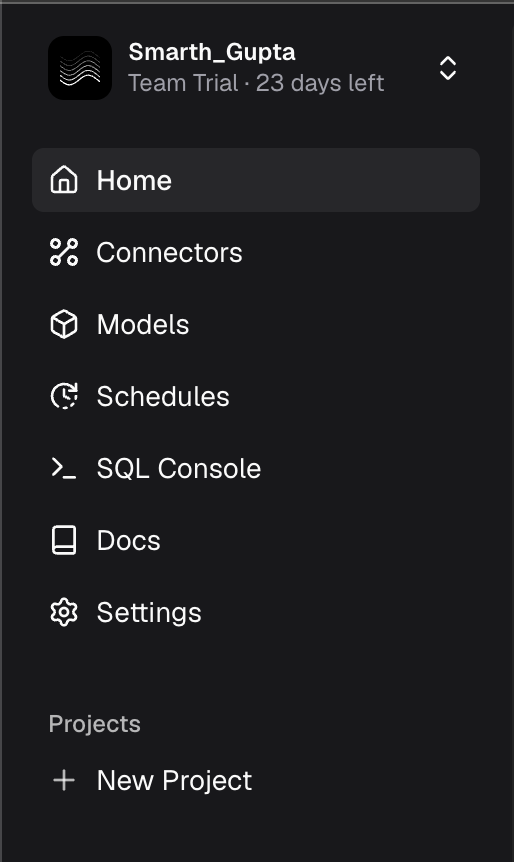

# Walkthrough details

%% Working draft. A fuller, self-contained account of every stage, following Sam's selected scope. The private raw log and planning notes preserve the full record. Excluded observations must not be reintroduced here. %%

Back to [Evidence Studio Feedback](Evidence%20Studio%20Feedback.md)

## Setup and environment

I wanted a primary dashboard for checking my homelab's health and load, using telemetry already stored in Neon Postgres. I built Home Lab Analytics in Evidence Studio using a direct Postgres connection, then tried a separate build with Claude through the Studio MCP. I also used a second account to test invitations and live editing, and created a GitHub repository for the project.

These notes cover my exploration on 29–31 October 2026. The homelab build was a personal use case; I did not test the account-health customer scenario used in the analysis. The second account was also mine, rather than an independent participant.

## 1. Creating the project

I created Home Lab Analytics and started with a broad request:

> I want to create a live dashboard that shows various analytics from my homelab. I have the data being stored in a Neon DB. Help me create a dashboard.

I did not start with a detailed chart specification. The agent first told me to connect Neon before it could build the dashboard.

## 2. Connecting my database

The agent directed me to Connectors, outside the project. Once there, I couldn't consult the same agent alongside setup. Going back to ask something and returning meant re-entering some details in the partly completed form. I found myself wondering whether the agent could handle the setup with me instead. It also supplied a connection-page link that didn't navigate when I clicked it.

I was trying to understand how to schedule a sync. The instructions and docs referred to Sources and Connectors navigation I couldn't easily find. When I asked about scheduling, the agent corrected its earlier advice and recommended a direct Postgres connection. I still wasn't confident about the choice between direct and synced connections.

After adding the direct connection, I asked how to add the synced one. The agent started building the dashboard. Its completion message explained that it was using the working direct connection and considered syncing unnecessary. I went on to accept the page, although the setup path had involved more backtracking than I expected.

## 3. Building the report with the agent

I told the agent this would be my main view of homelab status, health, and load, then asked what components it would suggest from the available data. It suggested health indicators, node status, trends, and pipeline information, and pointed out telemetry I wasn't collecting yet. I liked that it connected suggestions to my actual data and goal; I added sources based on those recommendations.

Changes were staged for me to accept. I liked seeing components appear in preview as the agent wrote them, with the Markdown and SQL available to inspect. The agent seemed particularly good at working with Evidence's framework. That combination helped me decide what to build without losing sight of the code behind it.

## 4. Fixing errors

Hovering over a diagnostic gave me an action to send it to chat. It included the message and line reference in a prepared prompt asking for a concise edit. I liked not having to assemble that prompt myself.

During a request to add temperature components, I used that shortcut. It interrupted the request, and the temperature work did not finish until I prompted the agent again.

Separately, the agent asked me to accept changes while I could see about five errors at the top of the page. My recollection was a type issue around a `max` expression; I did not preserve the exact diagnostic text. I accepted anyway, without being clear about what had been checked.

Warnings also went into chat with the same “component error” wording. In one supplied repair response, the agent explained its change but said it had not looked at the rendered temperature section. These episodes made me want a clearer distinction between making an edit and checking the result.

## 5. Previewing and live data

I wanted frequently updating data and asked whether the one-second refresh setting applied in the editor preview or only after publishing. The answer did not establish that behavior for me. I did not resolve it during the walkthrough, so I am recording uncertainty rather than claiming that preview refresh was broken.

## 6. Building the same page with Claude over MCP

I asked Claude to build a separate page with the same basic homelab goal through Evidence's Studio MCP. I liked that it rendered and checked the page before handing over the result. It couldn't save the page through that interface, so it supplied code for me to paste into Studio. This was a second build, not a controlled comparison of models or a check of every displayed value.

The useful takeaway for me was the render-and-check loop before handoff. I am not using this run to claim that one model is stronger or that successful rendering proves the analysis correct.

## 7. Inviting a teammate

I tested with a second account. The invitation let me create an account through the link, and I could see edits appear live in both sessions before connecting GitHub. This was my own two-account test, not a separate teammate trying the workflow.

I liked that someone could enter through an invitation without already having an Evidence account, and that shared editing worked before I linked the project to GitHub.

## 8. Connecting GitHub and publishing

I had already connected GitHub with access to all repositories before making this project. When I tried to link the project to its new repository, Studio did not recognize that existing installation. The connection flow kept taking me to GitHub, which said the app was already installed and offered configuration.

I changed the installation to selected repositories and selected the repository I had created for this project. Studio then recognized it and let me select it. That was the workaround that worked in my session; I don't know why the existing configuration wasn't being picked up.

## 9. Coming back later

After closing and reopening my main account, I could still see the title of a recent conversation, but opening it returned “chat not found.” I couldn't get back to that conversation. This describes lost access to the chat; I don't know what happened to it internally.

## General navigation

When I clicked Docs, it opened a separate site. The other buttons next to it kept me in Studio, so I had expected an integrated documentation view. I did appreciate that functions also have tooltips linking to the docs.

On the Schedules page, the Support button did nothing when I clicked it. I did not investigate the cause or test whether it behaved the same way in another session.

