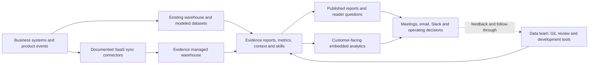

# Evidence: target market, customer workflows, and unmet needs

Research date: **2026-11-02** · Internal research supporting [[Evidence Studio - Product Review]] and [[Product Review Plan]].

## The best-supported market hypothesis

**Evidence targets organizations that want their data team to own a reusable analytics system, while making its outputs usable by people who do not maintain analytical code.** The maintainers define reports, metrics, context, access, and analytical procedures; colleagues or customers consume reports and investigate questions. The common thread is turning data-team expertise into something that can be safely reused and maintained.

This is a stronger description than either “dashboards for developers” or “chat with your database.” The current website separately markets internal analytics, an analytics agent, embedded analytics, and enterprise controls. That establishes intended use, not the relative revenue or adoption of each segment. [Current positioning](https://evidence.dev/)

The strongest candidate customers have three conditions: **valuable recurring analytical work, someone able to maintain its logic, and other people who need to use the result**. That maintainer could be an in-house analyst, an analytics engineer, a developer, or a delivery partner. Industry and company size matter less to this initial hypothesis than data readiness, operating constraints, and who owns the work.

### What is established, and what is inferred

- **Documented:** product capabilities, intended workflows, commercial packaging, and the specific customer/employer accounts cited below.
- **Inferred:** likely champions, budget owners, buying triggers, unmet needs, and which segment is the strongest fit. These are hypotheses to investigate, not a disclosed Evidence ICP or customer survey.
- **Observed locally:** Sam's Home Lab Analytics walkthrough. It provides concrete usability evidence, not validation of enterprise demand or all documented capabilities.
- **Still unknown:** customer/revenue mix, win/loss reasons, segment retention, willingness to pay, and measured outcomes for the workflows below. Logos and connector lists cannot answer those questions.

Research follows **product → workflow → surrounding stack → work roles → desired outcome → value delivered/gaps**. Historical examples are dated; pre-Studio framework use is not relabeled current Studio adoption.

## 1. Read the product portfolio as evidence of whom it serves

| Product signal | Explicit offer | Market implication — inference |
|---|---|---|
| Internal Analytics | SQL/Markdown reports, code review/versioning, reusable visual components, and controlled sharing. [Product](https://evidence.dev/product/internal-reporting) | A data/reporting owner wants to ship polished outputs without maintaining a custom frontend for every report. Code-oriented authors are the entry point, not necessarily the whole user base. |
| Analytics Agent | Business questions, customer health, product deep dives, pipeline reviews, and board preparation grounded in existing project knowledge. [Product](https://evidence.dev/product/analytics-agent) | A data team serves Finance, Product, Sales, Marketing, Support, and leadership; the consumer's job is to make a decision, not write a query. |
| Embedded Analytics | Branded reports delivered inside another application. [Product](https://evidence.dev/product/embedded-analytics) | A software/data-product organization has a second customer: its own external user. Analytics becomes part of the product experience, involving product and application engineering as well as data. |
| Enterprise | Warehouse, identity, audit, deployment, and AI-provider controls. [Product](https://evidence.dev/product/enterprise) | Platform/security teams can be buying gates. A compelling analyst experience alone may not satisfy deployment, identity, or procurement constraints. |
| Core versus Studio | Open-source framework/runtime versus the hosted collaborative platform. [Core announcement](https://evidence.dev/blog/evidence-core), [Self-hosting](https://docs.evidence.dev/self-host) | Distinguish adoption of a reporting framework from buying the complete platform. Solo builders and partners can enter through Core; hosted customers buy a different operating model. |

**Commercial signal:** Team is currently listed at **$2,500/month with unlimited users**, including agent/MCP capabilities and 20K monthly AI credits. Embedding, external customer/viewer access, row-level rules, and additional enterprise controls are listed under Enterprise. This suggests organization-wide value and separate embedded/governance buying conversations; it does not establish an employee-size cutoff or superior total cost. Core remains a separate entry route. [Pricing, checked 2026-11-02](https://evidence.dev/pricing)

## 2. Target segments to distinguish

The first three are product-supported buying/use patterns, not a ranking of Evidence's largest businesses. Research/public reporting and partners are additional adoption patterns with different evidence.

| Segment | Likely champion / buyer to validate | Buying trigger and desired result | Evidence strength |
|---|---|---|---|
| **A. Data teams maintaining internal reporting** | Senior analyst or analytics engineer; Head of Data/Analytics as likely sponsor. | Recurring reports, repeated metric changes, fragmented definitions, and a growing stakeholder audience. Maintain consistent decision products without repeated rebuilding. | Strong intended fit; native-warehouse blog describes actual, unnamed customers coordinating dbt and reports. Existence supplies named employer evidence. |
| **B. Data teams enabling governed self-service** | Data/analytics lead, with departmental champions and IT/security approval where needed. | Repeated questions and one-off AI artifacts create review burden. Give users useful answers while retaining reusable logic and organizational context. | Strong stated strategy; an anonymous customer-health skill case illustrates a real workflow. Adoption and saved analyst effort are not measured here. |
| **C. Teams shipping customer-facing analytics** | Data-product owner, product/engineering lead, or CTO; data team may own report content. | Customers expect analytics inside a product, but custom frontend work and tenant-specific access are expensive to maintain. Ship and revise analytics through a production workflow. | Explicit product/Enterprise offer and unnamed deployments; named current Studio buyer/outcome evidence remains limited. |
| **D. Research and release-linked data reporting** | Research/data engineer or scientific analyst; sponsor depends on the institution. | A released dataset needs interpretable quality/composition results and version context. Communicate what changed and whether the release is trustworthy. | Every Cure supplies a concrete framework artifact. Not evidence of a major Studio commercial segment. |
| **E. Implementation partners and agent-platform builders** | Consultancy/data-platform builder, acting for less technical clients. | Deliver reusable analytics within a wider data or software project. Reduce bespoke visualization work and maintain outputs across engagements. | Brighthive and Flipside provide specific public implementation accounts. End customers and downstream revenue are not established. |

Segments A and B may be the **same buying organization** serving different users; do not double-count them as separate customer accounts. Enterprise is a set of requirements across segments, not an industry. [Native-warehouse customer pattern](https://evidence.dev/blog/native-warehouse-support), [Agent strategy](https://evidence.dev/blog/evidence-agent), [Embedded launch](https://evidence.dev/blog/embedded-analytics)

### Actual adoption evidence and its limits

| Organization/account | What the source establishes | What it does not establish |
|---|---|---|
| **Existence** | Its Senior Data Analyst posting explicitly names Evidence.dev, Snowflake, Dagster, and Mixpanel, with recurring business reporting responsibilities. | Edition, actual report inventory, purchase rationale, or all described work already being implemented. [Employer posting](https://www.linkedin.com/jobs/view/senior-data-analyst-at-existence-4471755972) |
| **Every Cure / MATRIX** | A March 2025 release introduces Evidence dashboards paired with knowledge-graph releases, including quality/connectivity reporting. | Current Studio use, payment, or clinical decision support. This is research-data reporting. [Release](https://docs.dev.everycure.org/releases/2025/03/06/v040/) |
| **Zitcha** | Evidence's August 2023 Northstar-report guide names collaboration with Zitcha's data team and its Head of Data. | A current contract, edition, or that Zitcha's customer-facing platform uses Evidence. Zitcha describes itself as a retail-media platform independently. [Historical collaboration](https://evidence.dev/blog/northstar-reports), [Zitcha's business](https://www.zitcha.com/zitcha-the-retail-media-platform-built-for-retailers) |
| **Brighthive** | Its March 2025 CEO interview describes an agent generating/refining shareable dashboards using open-source Evidence. | Brighthive's overall agent/pipeline functions being Studio features, or every downstream client being an Evidence customer. [Interview](https://www.brighthive.io/post/brighthive-your-ai-powered-data-team) |
| **Flipside** | Its own site offers unified reporting built on Evidence alongside broader Odoo/e-commerce/integration services. | Which clients use Evidence, edition, scale, or outcomes. [Partner account](https://flipside.be/en) |
| **Anonymous customer-health example** | Evidence describes an existing customer's dashboard becoming a reusable analytical skill. | Customer identity, revenue contribution, or independently audited results. [August 2026 account](https://evidence.dev/blog/that-dashboard-should-be-a-skill) |

This supports a horizontal, workflow-led market across consumer software, retail media, research, and software/services delivery. It does **not** justify declaring finance, healthcare, government, or any other vertical Evidence's principal market from logos or demo datasets alone. Further customer provenance remains in [[Customer Use Case Research]].

## 3. Four workflows that explain the customer need

### W1 — Maintain a recurring business report as the data model changes

**Starting situation:** an analyst owns a daily product report or a weekly business review. A metric definition or upstream schema changes; multiple reports and readers depend on it.

**Work:** agree on meaning/grain with stakeholders → prepare trusted datasets → update the report and shared definition → review against the intended environment → publish → distribute → answer follow-ups → revise next cycle.

**People/data/deliverables:** analyst and analytics engineer, with Product/Growth/Finance leaders; behavioral events, acquisition spend, subscriptions, and targets; KPI report, cohort/funnel views, executive narrative, and later corrections. Existence's posting supports this business/reporting split. Its analyst owns metric correctness and decision communication while its data engineer owns the warehouse and pipelines. [Existence](https://www.linkedin.com/jobs/view/senior-data-analyst-at-existence-4471755972)

**Why Evidence could matter:** the vendor describes customers maintaining dbt/Evidence together and coordinating changes in a PR, with development-target switching. Report components can also consume named metric definitions. This is a fit for an existing engineering practice, not an obligation for every reader to learn Git. [Warehouse/dbt workflow](https://evidence.dev/blog/native-warehouse-support), [Reusable metrics](https://docs.evidence.dev/core-concepts/metrics)

**The real need:** readers get the same correct meaning after a change, and the maintainer can explain/review what changed. Code history alone does not retain historical data or guarantee correct metrics. Test the second revision and reader interpretation, not only time to the first chart.

### W2 — Turn a specialist's analytical procedure into guided self-service

**Starting situation:** a customer-success colleague is preparing for an account review. Usage, support, account hierarchy, and renewal context must be interpreted together; a dashboard has accumulated many inputs.

**Work:** identify account versus buying group → choose a relevant period/cohort → inspect adoption and support changes → check anomalies and source freshness → produce a focused account assessment → agree on an action with the account team.

**Evidence's documented response:** an August 2026 customer example replaces a complex health dashboard with a skill that asks relevant questions and guides the analysis. The maintained artifact becomes an analytical procedure as well as a report. The case is unnamed, and no time-savings measurement is established. [Customer-health skill](https://evidence.dev/blog/that-dashboard-should-be-a-skill)

**The consumer need:** arrive prepared with a defensible interpretation and next action, not a larger chart collection. **The maintainer need:** encode the method once and review changes to it. GitLab's public CS workflow illustrates the broader occupation: health/renewal reviews lead to agreed actions and owners recorded in operating systems. GitLab is a role/workflow reference here, not an Evidence customer. [CS review practice](https://handbook.gitlab.com/handbook/customer-experience/csm/csm-manager/)

**What to verify:** can a less technical user handle ambiguous account names, missing data, and conflicting signals; inspect the basis of the answer; and carry the result into the existing account workflow? A CRM data connector alone does not complete that last step.

### W3 — Ship analytics inside a customer-facing product

**Starting situation:** a product team needs customer-specific reporting without repeatedly translating analytical logic into bespoke frontend code.

**Work:** data team defines query/metric/report → product/design agrees on presentation → application backend requests the user's embed session → frontend displays the report → access filtering applies → changes are reviewed and released → support handles session/data issues.

**The concrete integration:** Evidence's embed docs require a backend endpoint and an iframe. The host application retains work around authentication, user attributes, session refresh, loading/error states, and integration testing. Optional embedded AI chat is documented as page-scoped: it runs the page's saved queries rather than arbitrary SQL. That scope differs from broad internal exploration. [Embed implementation](https://docs.evidence.dev/features/embedded-analytics)

**Success:** customers can answer their question inside the product, see only their permitted data, and use a polished experience after updates. Reducing report-frontend work does not eliminate application engineering.

**What to verify:** tenant isolation on the intended connector, session behavior, responsiveness, customization, support ownership, and release regression checks. Enterprise packaging and integration effort are purchase considerations, not incidental implementation details. [Embedded offer](https://evidence.dev/blog/embedded-analytics)

### W4 — Explain and validate a released dataset

**Starting situation:** a research/data team changes the composition of a dataset and must communicate the difference to collaborators.

**Work:** produce quality metrics → identify release and generation time → compare composition/connectivity → explain material changes → publish a report tied to the release → retain the ability to distinguish prior results.

Every Cure's MATRIX release documents this use directly: each knowledge-graph release is paired with an Evidence dashboard. [Release account](https://docs.dev.everycure.org/releases/2025/03/06/v040/)

**Needs:** reproducibility, explicit version context, known definitions, and communication that does not require every reader to inspect pipeline code. A data/research engineer is a plausible maintainer, but exact owners and reviewer roles were not established.

**Fit:** a strong framework-use example, with limited evidence about hosted-platform buying. Sam's homelab test is most transferable here in its freshness, pipeline, and missing-data questions—not as evidence that research teams need a one-second monitoring console.

## 4. People behind the workflows

These are work-role profiles, not invented demographic personas. Titles, reporting lines, degrees, and experience vary. The common skills below are either supported by the cited role sources or explicitly inferred from the documented work.

| Role | Responsibilities and deliverables | Relevant background / surrounding work | What value would look like |
|---|---|---|---|
| **Senior data/product analyst — author and translator** | Define KPIs, investigate behavior, read out experiments, maintain reports, and recommend action to business leaders. | SQL, domain metrics, statistics, and executive communication. Existence asks for 5+ years and names Snowflake, Mixpanel, and optional Python. This is one employer's profile, not a universal requirement. | Correct, understandable decisions; less report rework; consistent definitions. Evidence's reporting layer does not establish full experimentation/statistics coverage. [Role source](https://www.linkedin.com/jobs/view/senior-data-analyst-at-existence-4471755972) |
| **Analytics engineer — model/context maintainer** | Produce reusable tested datasets, documentation, and definitions; coordinate upstream/downstream changes. | SQL, dbt/warehouse, Git/testing/CI; a route from analysis, engineering, or BI is plausible. dbt describes the role as transformation/testing/documentation work, distinct from pure dashboard creation. | Model changes do not silently break reports or agent answers; one maintained meaning reaches multiple consumers. [Role definition](https://www.getdbt.com/blog/what-is-analytics-engineering) |
| **Data/platform engineer — enabler and gatekeeper** | Own reliable ingestion, compute, credentials, data security, and platform operations. | Warehouse/cloud, orchestration, observability, and access design. GitLab's public data-team model distinguishes platform and analytics responsibilities; this is industry context, not Evidence adoption evidence. | Fresh/reliable data, bounded query cost, operable integrations, clear ownership when failures cross systems. [Team model](https://handbook.gitlab.com/handbook/enterprise-data/) |
| **Customer-success / commercial operator — decision user** | Prepare account reviews, explain adoption and risk, agree on outcomes, coordinate renewal/expansion actions. | Customer/domain knowledge, communication, CRM/CS tools; SQL fluency should not be assumed. GitLab's CSM role explicitly turns usage data into advice. | A useful account narrative and follow-through, with explainable signals and minimal analyst dependence. [Role definition](https://handbook.gitlab.com/job-description-library/sales/customer-success-management/) |
| **Product/app engineering owner — embedded co-owner** | Integrate sessions/identity, match UI, handle failure states, and release customer-facing analytics. | Backend/frontend/authentication skills are implied by the embed implementation; no specific customer job title was verified. | Fewer custom reporting layers without surrendering application quality, tenant isolation, or release control. [Implementation duties](https://docs.evidence.dev/features/embedded-analytics) |
| **Data leader and IT/security sponsor — buyer/gatekeeper hypotheses** | Allocate budget, define ownership, oversee governance, evaluate vendors, and sustain adoption. | Management/domain/platform experience varies; do not assume the champion holds the budget. Enterprise requirements may introduce procurement and security reviewers. | Reduced maintenance/review burden and useful adoption at an acceptable total operating cost—not merely more AI usage. [Enterprise requirements](https://evidence.dev/product/enterprise) |

**Important implication:** technical authors and business consumers are complementary audiences in the same system. A business user creating an insight does not remove the need for someone to own definitions and procedures. A 2026 dbt article similarly describes AI context and governance as expanding analytics-engineering responsibilities; this is a vendor perspective, not proof that every team has adopted that model. [Role evolution](https://www.getdbt.com/blog/the-analytics-engineer-in-2026-system-designer-governance-owner-ai-context-provider)

## 5. The surrounding stack: where Evidence fits

This is a synthesized workflow map, not a claim that every customer uses every layer. Existing-warehouse and managed-ingestion routes are alternatives; an organization may not need both. Evidence also documents beta SQL models, so it can perform some preparation; that does not prove it replaces the customer's full orchestration/modeling platform. [Data architecture](https://docs.evidence.dev/evidence-warehouse), [Models](https://docs.evidence.dev/core-concepts/models)

### Integration map: classify the connection, not just the logo

**D = documented capability; A = adjacent tool/workflow; U = exact end-to-end integration unverified.** The presence of a connector is not a tested reliability, permission, commercial-availability, or freshness guarantee.

| Stack/tool | Evidence relationship | Customer implication / boundary |
|---|---|---|
| **Snowflake, BigQuery, Fabric and other direct databases** | **D:** direct-warehouse route; Postgres explicitly includes Neon compatibility. [Architecture](https://docs.evidence.dev/evidence-warehouse), [Postgres](https://docs.evidence.dev/direct-connectors/postgres) | Can use existing modeled data. Connector-specific identity/RLS matters: current Postgres docs say queries use one configured role, without per-viewer identity mapping. Do not apply every warehouse's controls universally. |
| **dbt; Dagster/Airflow-style orchestration** | **D:** dbt environment workflow described by Evidence. **A:** Existence names Dagster upstream. **U:** Evidence triggering or waiting for a Dagster run was not established. [dbt workflow](https://evidence.dev/blog/native-warehouse-support), [Existence](https://www.linkedin.com/jobs/view/senior-data-analyst-at-existence-4471755972) | Querying a modeled table does not show that report delivery follows pipeline completion or carries its freshness/lineage context. Investigate that handoff before asking for another connector. |
| **Cube and metric definitions** | **D:** Cube SQL connector; Evidence also has its own reusable metric definitions. **U:** automatic dbt MetricFlow/other semantic-definition synchronization was not established. [Cube](https://docs.evidence.dev/direct-connectors/cube), [Metrics](https://docs.evidence.dev/core-concepts/metrics) | Data teams need an explicit source of truth and change process; avoid accidentally maintaining contradictory definitions in several places. |
| **Salesforce and Zendesk** | **D:** documented Fivetran-powered source syncs. [Salesforce](https://docs.evidence.dev/data-sources/salesforce), [Zendesk](https://docs.evidence.dev/data-sources/zendesk) | Supports account/support analysis. It does not establish creating CRM tasks, updating opportunities, or closing a support-action loop. |
| **Mixpanel, PostHog and marketing/billing systems** | **D:** Mixpanel/PostHog source docs and a broader connector catalog; warehouse route can also use already-ingested data. [Mixpanel](https://docs.evidence.dev/data-sources/mixpanel), [PostHog](https://docs.evidence.dev/data-sources/posthog) | Reporting can combine product/business measures. That is not proof of replacing event instrumentation, experimentation, attribution, or each source tool's native investigation features. |
| **Notion and Confluence** | **D:** both have source-sync pages. **U:** automatic conversion of their content into maintained agent context, or a publishing loop back into those tools. [Notion](https://docs.evidence.dev/data-sources/notion), [Confluence](https://docs.evidence.dev/data-sources/confluence) | “No integration” would be inaccurate. Check content coverage, freshness, permissions, and whether the business glossary actually reaches the agent. |
| **GitHub; GitLab** | **D:** GitHub repository workflow. GitLab has a **data-source** connector, while Studio version-control docs name only GitHub. [Version control](https://docs.evidence.dev/features/version-control), [GitLab source](https://docs.evidence.dev/data-sources/gitlab) | Importing GitLab activity is not using GitLab to review/deploy Evidence projects. That distinction can be a real buyer constraint. |
| **Claude/Cursor and other coding environments** | **D:** local CLI/Git authoring plus MCP discovery/query/render. The Studio MCP tool list has no page-save action. [CLI](https://docs.evidence.dev/cli), [MCP](https://docs.evidence.dev/mcp/studio) | An external-agent reader/query workflow and a local authoring workflow have different completion boundaries. Sam's manual code handoff is relevant evidence here. |
| **Slack, email; Microsoft Teams** | **D:** scheduled PDF delivery through email/Slack, plus agent positioning in Slack. Pricing mentions Teams **support**; a comparable Teams bot/report-destination workflow was not established. [Schedules](https://docs.evidence.dev/features/scheduled-reports), [Agent](https://evidence.dev/product/analytics-agent), [Pricing](https://evidence.dev/pricing) | Do not confuse a support channel, a source connector, and the end user's delivery/action interface. Check where the intended team actually works. |
| **Gainsight / CRM operating workflows** | **A:** GitLab's CS process uses Gainsight/Salesforce for health, renewal review, and follow-through. **U:** Gainsight integration was not established in the consulted Evidence catalog. [Occupational workflow](https://handbook.gitlab.com/handbook/customer-experience/csm/csm-manager/) | A good account analysis may still require a separate operating-system action. A warehouse bridge may suffice for reading; bidirectional actions are a different question. |
| **Spreadsheets, slide decks, documents** | **D:** homepage advertises PDF/XLSX exports; scheduled delivery documents PDF. **U:** editable PowerPoint or spreadsheet round-trip authoring was not established. [Exports](https://evidence.dev/), [PDF delivery](https://docs.evidence.dev/features/scheduled-reports) | Inspect the actual meeting/board deliverable. A supported export need not preserve the editable workflow a Finance or executive-support user expects. |
| **Identity, cloud, audit and application auth** | **D:** enterprise identity/deployment offers and embedded-session API. Specific providers, plans, and connectors must be checked. [Enterprise](https://evidence.dev/product/enterprise), [Embed](https://docs.evidence.dev/features/embedded-analytics) | Security/platform teams evaluate the complete access and operational path, not the visualizations alone. |

**Research correction:** the warehouse overview lists only a subset of application connectors. The full docs catalog includes Salesforce, Mixpanel, Notion, Confluence, GitLab, and Zendesk. We read their individual connector pages. Lack of a name on the overview is not evidence of absence.

## 6. Which needs appear served—and where proof is still missing

| Customer need | Current value evidence | What remains unresolved | Assessment |
|---|---|---|---|
| Maintain analytical logic with software-development practices | Product/docs support files, own repo, preview/review, and publishing; customer blog describes dbt/report co-development. | Actual maintenance savings, model/report correctness after revisions, and mixed-author recovery. | **Strong architectural fit; operational benefit to test.** |
| Communicate meaning, not just show numbers | Northstar guidance emphasizes drivers, context, and an executive-readable narrative. | Whether target readers understand and use the report without the author explaining it. | **Explicit, longstanding product job; not just an AI trend.** [Northstar](https://evidence.dev/blog/northstar-reports) |
| Answer new questions using shared definitions and methods | Report-grounded agent, maintained context/skills, reusable metrics, and an anonymous customer-health workflow. | Answer correctness, ambiguity handling, review workload, adoption, and cost per useful decision. | **Credible product mechanism; outcome evidence incomplete.** |
| Ship customer-facing analytics with less bespoke work | Enterprise embedded offer plus explicit integration contract; Brighthive demonstrates a separate open-source agent-to-report route. | Full implementation burden, connector-specific tenant isolation, UX, and named Studio results. | **Clear intended fit; do not call it engineering-free.** |
| Get the analysis into the work | Published-reader agent, subscriptions, email/Slack distribution, exports, and embedding are documented. | Meetings and follow-through; whether delivery becomes an action in the customer's actual tools. | **Several delivery surfaces; closed-loop workflow still to investigate.** |
| Let more users participate without losing control | Enterprise and access-layer options, organizational pricing, curated analysis artifacts. | Correct plan/connector combination, source scope, procurement fit, and ongoing ownership. | **Conditional fit; not a universal governance guarantee.** |

Sam's positive recommendations/preview/co-editing experience supports value in the build loop. Setup state loss, interrupted repair, readiness uncertainty, and the publish warning challenge the surrounding operating workflow. These observations are relevant to the maintainer roles above; they do not establish the experience of a Finance reader or embedded customer. See [[Evidence Studio - Review Evidence]].

### A real non-adopter shows why “technical team” is not enough

Fluid Attacks documents evaluating Evidence while retaining D3/Billboard for precomputed frontend analytics. It cites Enterprise embedding cost, GitLab workflow fit, and OSS authentication burden. Its stated workflow and selection concerns are useful buyer evidence. Some broad statements should not be adopted as current product facts: Evidence does support an owned GitHub repo, and current self-hosting includes basic-auth configuration rather than full Studio governance. [Evaluator account](https://docs.fluidattacks.com/stack/dependencies/d3), [Current self-hosting](https://docs.evidence.dev/self-host)

**Interpretation:** a team can be highly technical, use Snowflake, and still prefer its existing frontend/data-delivery architecture. The deciding constraints may be repository provider, deployment surface, licensing, and operational fit rather than dislike of drag-and-drop.

**Documentation discrepancy to resolve:** the Enterprise marketing page says GitHub Enterprise self-hosted or cloud instances; current publishing docs explicitly exclude self-hosted GitHub Enterprise Server. Record this as a vendor clarification question, not confirmed server support. [Marketing](https://evidence.dev/product/enterprise), [Publishing](https://docs.evidence.dev/publishing)

## 7. Implications for product feedback and market fit

1. **Evaluate the maintainer-to-consumer contract.** The relevant outcome is not a technically impressive dashboard. It is a report or procedure the maintainer can change and someone else can use correctly. The original “technical Evidence versus nontechnical Hex” framing is too coarse; Evidence explicitly intends both roles.
2. **Treat recurring use as the main value test.** Evidence's own historical explanation concerns fragmented authoring tools and repeated stakeholder questions. Test whether a maintained report/skill actually reduces repeat work, rather than whether the agent generates more content. [Two Kinds of Job, 2023](https://evidence.dev/blog/two-kinds-of-job)
3. **Keep agent-centered interaction separate from unbounded autonomy.** A durable need is to carry approved definitions, scope, and methodology into new questions. Chat as the default layout, autonomous administration, and a larger addressable audience remain solution/commercial hypotheses. The platform already markets agent-first investigation; feedback should test how well that promise reaches users.
4. **Prioritize integrations by broken jobs.** Reading Salesforce is different from updating an account plan. Ingesting Notion is different from keeping business context current. Querying dbt outputs is different from coordinating a report with model completion. Find the costliest handoff before proposing another logo integration.
5. **Separate Core adoption from Studio conversion.** A successful research artifact or partner integration proves something about the framework, not necessarily demand for the hosted platform. Ask what additional operating work Studio removes and who pays for it.
6. **Do not extrapolate from the homelab to the whole market.** Keep it as an exploratory stress test. Reproduce important issues, then test at least one recurring business workflow and one independent reader. The target-market argument should not become a request that Evidence compete as a general observability suite.

### The working value proposition to test

> For a data team responsible for trusted recurring analysis, Evidence offers a shared reporting language and runtime for reports, metrics, and agent-guided procedures. The intended benefit is to make that expertise reusable by colleagues or customers while keeping its maintenance in a reviewable development workflow. Studio is valuable if it makes that shared operation materially easier than stitching together the alternatives.

This is a buyer/workflow hypothesis. It is not a proven competitive win, a disclosed corporate strategy, or a claim that every capability is unique.

## 8. Research needed to validate the market hypothesis

### Ask for behavior and artifacts, not general preferences

| Participant | Ask them to show | What it would establish |
|---|---|---|
| Current report maintainer | Last report revision, upstream model change, review, and a failure/recovery. Who requested it and why? | Where maintenance value and friction actually occur; tools and ownership. |
| Business consumer / departmental champion | Last decision, report/question used, uncertainty, next action, and where that action was recorded. | Whether analysis is useful in the operating workflow, and whether self-service reduces dependence. |
| Embedded product owner + application engineer | An actual embed integration, tenant test, release, session error, and support incident. | Work removed versus work retained by Evidence, and must-have integration constraints. |
| Data-platform/security owner | Connection/identity setup, allowed/denied access example, data freshness incident, and procurement requirements. | Real deployment/gatekeeping needs, beyond marketing capability lists. |
| Buyer / former evaluator | Prior alternative, shortlist, decisive requirement, implementation effort, renewal criterion, and why they did/did not choose Studio. | Segment fit, willingness to pay, and actual competitive rationale. |
| Partner | How a second client or later report differs from the first; what is reused and what stays custom. | Whether the partner channel scales Evidence's value or mainly sells bespoke service. |

Recruit across internal-reporting, embedded, Core/partner, and non-adopter cases rather than calling three public examples the top customers. Include a reader who did not build the report. Request anonymized walkthroughs if data is sensitive; no outreach has been performed.

### What to ask Evidence for internally

- Accounts and revenue segmented by Core/Studio, internal/embedded use, data-stack architecture, and buying/maintaining role; avoid double-counting readers as customers.
- Win/loss reasons and time from connection to first **consumed** report, not just first generated page.
- Subsequent report/metric/skill revisions, reader/insight reuse, delivery success, and review/recovery behavior.
- Repeated-question volume and analyst review burden before/after agent use, with answer-quality checks.
- Integration requests tied to blocked customer workflows and the required action direction: ingest, query, context, publish, or write back.
- Actual AI/warehouse/support costs and adoption concentration by user type; unlimited seats do not imply unlimited useful adoption.

Useful outcome checks include a reader identifying the correct metric and limitation, a definition change remaining consistent across outputs, a revision surviving review/publish, and an analysis leading to a recorded next action. These are proposed measures; no improvement percentages are established.

## What this changes in the existing review

The most important refinement is **not** that Evidence should discover conversational analytics. Its current product and August 2026 posts already place that experience at the center of its strategy. The review should ask whether its maintained reports, context, and procedures reliably serve both the technical owner and the downstream decision user.

For the next hands-on review, prioritize W1 plus an independent reader; add W2 to test analytical method/context reuse. Choose W3 only if embedded analytics is commercially important to the team. Use W4 as a concrete research/framework scenario without assuming it represents Studio's main market. Update the final report's segment emphasis after those validations; its current UX observations remain scoped to the homelab.

Related: [[Customer Use Case Research]] · [[Hex vs Evidence - Product and Growth Research]] · [[Product Review Findings]] · [[Evidence Studio - Product Review]]. No account access, customer interviews, connector execution, or live-product changes were performed in this research pass.
